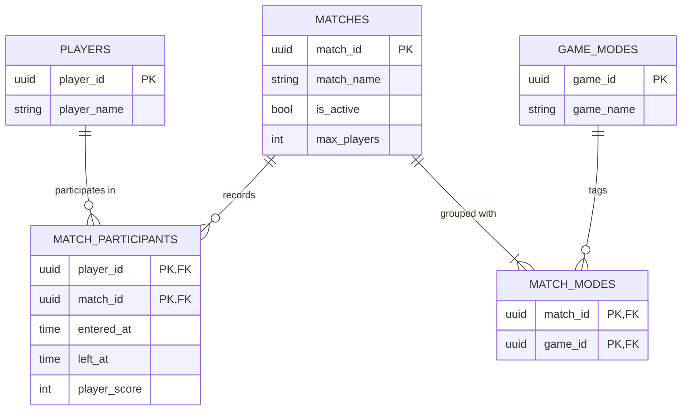

# Soccar Alliance

A relational database platform for capturing player activity, match history, and game-mode metadata for Soccar Alliance, a vehicle-soccer video game.

## Domain

## Schema

## Query Catalogue

## Technical Highlights

## What I Would Do Differently

## Video Presentation

## How to Run It
