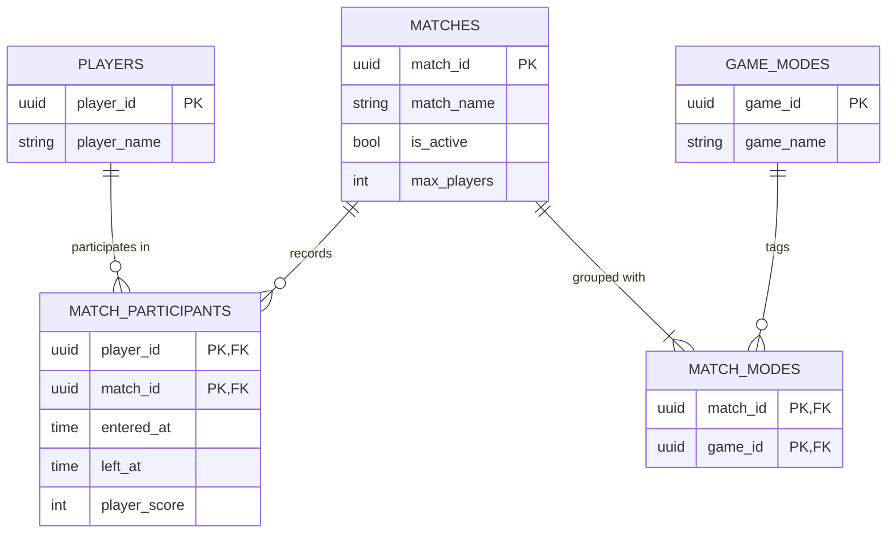

# Soccar Alliance

A relational database platform for capturing player activity, match history, and game-mode metadata for Soccar Alliance, a vehicle-soccer video game.

## Domain

## Schema

## Query Catalogue

### Unit 4 — Aggregation

| File       | Query                                     | Description                                                                                         |
| ---------- | ----------------------------------------- | --------------------------------------------------------------------------------------------------- |
| `q4_1.sql` | Platform-wide stats                       | `COUNT`, `SUM`, `AVG`, `MIN`, `MAX` of `score` + distinct player count across all events            |
| `q4_1.sql` | Per-match event count + avg score         | Groups by `match_id`, sorted most events → fewest                                                   |
| `q4_1.sql` | Volume threshold                          | `HAVING COUNT(*) >= 16` to filter to full matches only                                              |
| `q4_1.sql` | Two-dimension grouping                    | Groups by `server_region` via `LEFT JOIN` to `matches`; score stats per region                      |
| `q4_2.sql` | Failure count per match (Part A)          | Conditional aggregation — total participants + disconnected count in one pass using `SUM(CASE ...)` |
| `q4_2.sql` | Regional subtotals + grand total (Part B) | `GROUP BY ROLLUP(client_region, match_id)` filtered to subtotal and grand total rows only           |
| `q4_2.sql` | High-volume match baseline (Part C)       | CTE summarizes per-match avg score; outer query filters to matches with 16+ participants            |

## Technical Highlights

## What I Would Do Differently

## Video Presentation

## How to Run It
