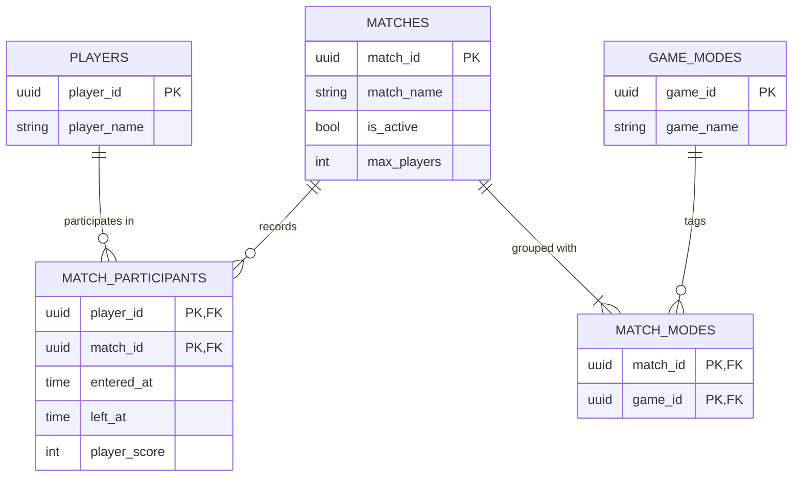

# Schema Definition

## PLAYERS (actor)

|   Column    |    Type     |          Constraints           |     Description     |
| :---------: | :---------: | :----------------------------: | :-----------------: |
|  player_id  |    UUID     | PK, DEFAULT uuid_generate_v7() |   Player v7 UUID    |
| player_name | VARCHAR(16) |        NOT NULL UNIQUE         | Public Display Name |

## MATCHES (producer)

|   Column    |    Type     |          Constraints          |          Description           |
| :---------: | :---------: | :---------------------------: | :----------------------------: |
|  match_id   |    UUID     | PK,DEFAULT uuid_generate_v7() |         Match v7 UUID          |
| match_name  | VARCHAR(30) |           NOT NULL            |       Public Match Name        |
|  is_active  |   BOOLEAN   |           NOT NULL            |    Flag for match activity     |
| max_players |   INTEGER   |           NOT NULL            | Max number of players in match |

## MATCH_PARTICIPANTS (event)

**Primary Key** (player_id,match_id)

|    Column    |    Type     |       Constraints       |          Description          |
| :----------: | :---------: | :---------------------: | :---------------------------: |
|  player_id   |    UUID     | FK -> players.player_id |           Player ID           |
|   match_id   |    UUID     | FK -> matches.match_id  |           Match ID            |
|  entered_at  | TIMESTAMPTZ |        NOT NULL         | Time player entered the match |
|   left_at    | TIMESTAMPTZ |                         |  Time player left the match   |
| player_score |   INTEGER   |        NOT NULL         |  Players score in the match   |

## GAME_MODES (catalog)
|  Column   |    Type     |          Constraints           | Description  |
| :-------: | :---------: | :----------------------------: | :----------: |
|  game_id  |    UUID     | PK, DEFAULT uuid_generate_v7() | Mode v7 UUID |
| game_name | VARCHAR(20) |            NOT NULL            | Name of game |

## MATCH_MODES (junction)
**Primary Key** (match_id, game_id)****
|  Column  | Type  |       Constraints        | Description |
| :------: | :---: | :----------------------: | :---------: |
| match_id | UUID  |  FK -> matches.match_id  |  Match ID   |
| game_id  | UUID  | FK -> game_modes.game_id |   Game ID   |

## ERD

